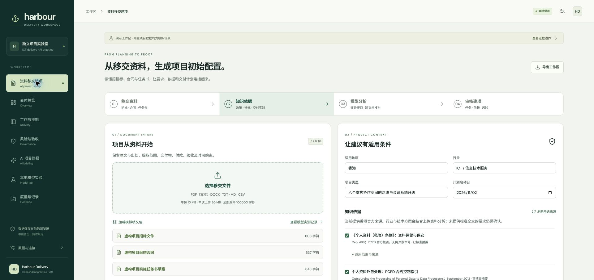

# Harbour Delivery

**A Hong Kong ICT handover and delivery prototype: turn presales documents into a source-linked project draft, then manage delivery with review, dependencies and acceptance gates.**

[Live demo](https://zivmryang.github.io/harbour-delivery/) · [Build and deployment](https://github.com/zivmryang/harbour-delivery/actions/workflows/pages.yml) · [Verification record](docs/VERIFICATION.md)

Harbour reads tender documents, contracts and statements of work with a local language model, combines their requirements with selected official guidance and uploaded technical references, and proposes a project configuration for review. The same workspace manages tasks, dependencies, RAID controls, acceptance and source-linked briefings. This is an independent, AI-assisted engineering project. All bundled project records and all training records are synthetic. The included scenarios are demonstrations; business impact has not been validated with production users.

## What works



- **Document-to-project setup:** TXT/MD/CSV, DOCX and text-layer PDF parsing in the browser; original and cleaned text, chunk locations and hashes retained. Scanned pages require OCR; image/table interpretation is not provided.
- **Two-stage model pipeline:** per-source extraction with exact quotation checks, then cross-document synthesis of requirements, WBS, dependencies, milestones, acceptance criteria, risks, conflicts and open questions.
- **Versioned knowledge inputs:** six curated Hong Kong official sources, explicit refresh status and applicability, plus uploaded industry/technical references. A fetched page is not a fresh legal review; no blanket assertion that every source is applicable.
- **Hong Kong delivery context:** explicit enterprise and government-outsourced-IT reference presets. Government security/procurement guidance is selected for review only when that scenario is chosen; personal-data and critical-infrastructure applicability still require project-specific confirmation. See the [Hong Kong tool environment and evidence](docs/TOOL-CHOICES.md#hong-kong-reference-environment).
- **Reviewed initialization:** resolve conflicts, confirm budgets, dates, durations, risk scores and optional recommendations, then create a new project with its proposal and review archived. Nothing is marked completed or accepted by the model.
- **Plan baselines and change control:** preserve named plan snapshots, compare current task dates/scope and project budget/target, propose schedule or budget changes, preview downstream calendar-day FS shifts, and record an apply/reject decision. Pending requests do not change execution data; stale plans and movement of completed tasks are blocked. These are local review records, not authenticated enterprise approvals.

- Three synthetic ICT scenarios, editable tasks, owners, suppliers, dates and dependencies; browser-local persistence and complete JSON backup.
- Kanban movement with acceptance gates: a task needs an owner, acceptance criteria, confirmation, evidence and accepted predecessors before it can be completed.
- Calendar-day, finish-to-start critical-path analysis. Explicitly not a resource-levelled replacement for Project or P6.
- RAID register, overdue/budget/dependency alerts and acceptance/handover checks.
- **Rules briefing** available offline, always labelled non-AI.
- **Real local model briefing** through Ollama Qwen3 0.6B, plus an optional server-side OpenAI Responses adapter. Drafts retain source IDs and require human review; changed source data invalidates review.
- **Actual MLX QLoRA training and deployment** for a separate bilingual project-record extraction task.
- Personal workflow measurements distinguish simulated examples from user-entered measurements. Local audit records are not independent attestations.
- Standard and Jira-style CSV import, Chinese column aliases, spreadsheet-safe CSV export. Other tools can map exports to the documented template; there is no pretended online account sync.

The UI is responsive and primarily Chinese, with English terminology and English project briefings. It is a single-user prototype, not a hosted multi-user project system.

After a handover plan has been reviewed, open **基线与变更** to save its initial baseline. Enter a change request, adjust the affected task dates, and optionally generate downstream shift suggestions. Preview the proposed dates and budget, submit the request, then record the review decision before applying it. The original baseline remains available. Comparisons show **current plans versus saved plans**, not actual progress or earned value. Direct task/project editing remains available and appears in baseline differences; only requests made through the change flow include a separate decision record. See the [official-source tool comparison](docs/TOOL-CHOICES.md) for the design references and unimplemented capabilities.

## Quick start

Requirements: Node.js 22+, npm. No API credential is needed for the UI or deterministic controls.

```sh
npm ci
npm run dev
# http://127.0.0.1:5173
```

For document analysis, install and start Ollama, then:

```sh
ollama pull qwen3:8b
# Optional separate small briefing model:
ollama pull qwen3:0.6b
npm run server
# In a second terminal:
npm run dev
```

Open **资料移交建项**, load the clearly marked synthetic handover pack or upload your own documents, select relevant knowledge, and start analysis. On a 16 GB Apple Silicon Mac, full analysis can take several minutes. Jobs expose progress and cancellation; no partial output is silently adopted. A recorded run is available on the static demo without sending documents to a model.

The frontend proxies `/api` to the local gateway on port 8787. Model API keys never go into browser source or storage. Optional gateway configuration is described in [.env.example](.env.example) and [AI setup](docs/AI-SETUP.md).

For the included **fine-tuned extraction adapter**, follow [Local model deployment and training](docs/LOCAL-MODEL.md). It uses Apple Silicon, Python 3.12, MLX and a pinned model revision. The adapter is included (~2.9 MB); base weights and virtual environments are excluded. Start `training/serve.sh`, then use **Model lab** in the app. The deployment was tested on a 16 GB Apple Silicon Mac.

## Actual experiment, not projected results

On 2026-10-29 we ran one preset 60-step QLoRA training job: rank 4, last 8 layers, batch size 1. The dataset contains 96 training, 16 validation and 16 independent synthetic test records with split-disjoint templates and entities.

| Held-out metric | Base model | Adapted model |
|---|---:|---:|
| Strict JSON/schema compliance | 0/16 | 14/16 |
| Field accuracy | 69/80 (86.25%) | 77/80 (96.25%) |
| Correct source ID | 16/16 | 16/16 |
| Entire record correct | 8/16 | 13/16 |

**Interpretation matters:** the base model often wraps JSON in Markdown. Field and record metrics strip only one such fence for both models; strict format compliance does not. There are three retained adapted-model errors involving missing values. Validation loss increased from step 30 to 60. No hyperparameter search or holdout-based checkpoint selection was performed. This small synthetic experiment does not establish real-world generalisation, customer impact or autonomous decision quality.

- [Machine-readable evaluation](public/model-evaluation.json)
- [Training configuration](training/config.yaml) and [actual training log](training/results/training.txt)
- [Base predictions](training/results/baseline.json), [adapted predictions](training/results/adapted.json)
- [Actual gateway-to-adapter call](training/results/gateway-smoke.json)
- [Real Ollama briefing and semantic review](server/live-smoke.json)
- [Live completion-conflict rejection](server/live-brief-guard-smoke.json), plus [a second observed failure](server/reported-completion-conflict-2.json) retained as a regression case
- [Original deployment failure](server/live-extract-failure.json) and [auditable name-case normalization](server/live-extract-normalized.json)

The adapter extracts five fields. It is **not** a fine-tuned long-form project planner. The Qwen3 8B handover pipeline, Qwen3 0.6B briefing and MLX extraction are separate. The evaluation above applies only to the five-field extraction experiment; it does not measure the 8B document pipeline. Unique ASCII name-case normalization in the gateway is a post-processing change and is not counted as a model-score improvement.

The 0.6B briefing model made false completion claims in real tests. A conservative task-state gate now rejects the observed contradictions, including claims made in recommendations. This is not general semantic verification; human review remains required and deterministic rules reporting is the default.

## Architecture

```text
React + TypeScript workspace (localStorage)
  ├─ deterministic validation / CPM / source-linked reports
  ├─ browser PDF / DOCX / text intake → source text
  ├─ reviewed proposal → new project + source/review archive
  ├─ CSV and JSON file exchange
  └─ local Node gateway :8787
       ├─ in-memory jobs → curated source refresh + uploaded references
       │    └─ Ollama Qwen3 8B → extract with quotes → synthesize project draft
       ├─ Ollama :11434 → separate general briefing model
       ├─ MLX :8080 → pinned Qwen3 base + extraction LoRA
       └─ optional OpenAI Responses → server-side credential

GitHub Pages → static UI, synthetic examples, evaluation artifacts
               (no hosted inference; no embedded secrets)
```

## Verify

```sh
npm run check
python3 training/verify_artifacts.py
```

Unit tests cover scheduling, evidence gates, malformed imports, CSV quoting/injection, source validation, model failures, authentication, CORS and request bounds. Live model evidence is stored separately from mocked unit tests. See [verification record](docs/VERIFICATION.md) for browser checks and known limits.

## GitHub Pages

The included `Verify and deploy` workflow tests and builds before deploying `dist/` using GitHub Actions. Configure **Settings → Pages → Source: GitHub Actions**. Asset paths are relative, so a repository-subpath deployment works.

The public site supports project editing, rules analysis, file exchange and reading the actual model results. GitHub Pages cannot run Ollama, Python training or a persistent Node gateway. For live inference, run the documented local stack or configure an authenticated HTTPS gateway. Public pages may be prevented by browser policy from accessing local HTTP services; localhost development is the supported on-device workflow.

No analytics are installed. Opening the app reads the knowledge catalogue; refreshing selected sources fetches only allowlisted official URLs. An explicit model-generation action sends selected document text and references to the configured gateway, and to the selected cloud provider if enabled. Input documents are never used to construct web fetch URLs. Job results remain in gateway memory for up to 30 minutes; approved archives persist in browser storage and exported backups. Keep confidential files and exports outside this public repository. Export your workspace before clearing browser data. This prototype has no shared accounts, cross-device synchronization, production access-control system or immutable audit log.

## Project documentation

- [Document-to-project engine](docs/HANDOVER-ENGINE.md)
- [Knowledge source catalogue and refresh boundaries](docs/KNOWLEDGE-SOURCES.md)
- [Tool choices and interoperability](docs/TOOL-CHOICES.md)
- [Project case study and demonstration](docs/CASE-STUDY.md)
- [Architecture decisions](docs/DECISIONS.md)
- [Local model experiment](docs/LOCAL-MODEL.md)
- [AI gateway](docs/AI-SETUP.md)
- [Verification and limitations](docs/VERIFICATION.md)

## License

Application code is MIT-licensed. The adapter's license and provenance are in [training/adapters](training/adapters/README.md). Base model weights are downloaded separately under their own license. This project is not affiliated with the project-management vendors referenced in the tool comparison.
