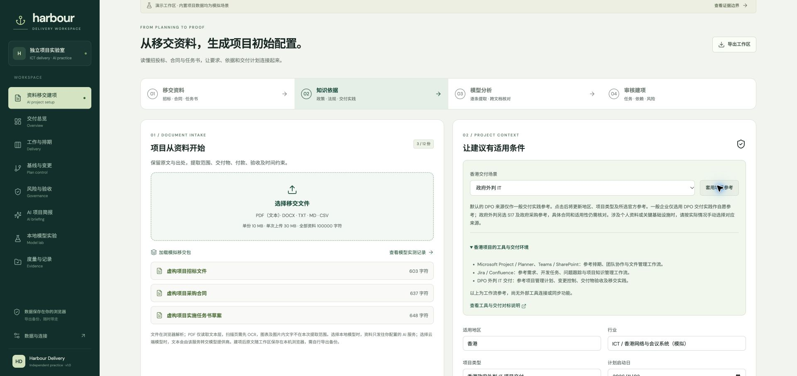
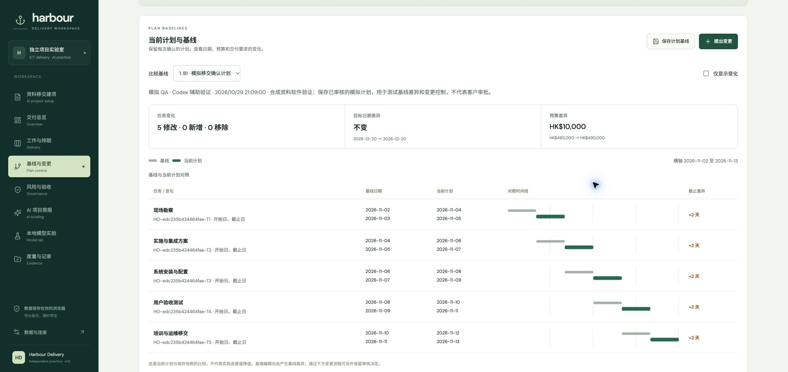
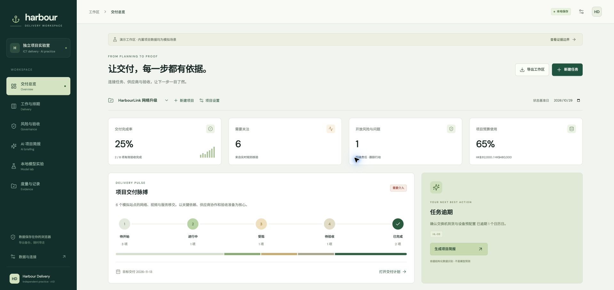

# Verification record

Verified on 2026-10-29 on an Apple Silicon Mac with 16 GB unified memory, Node.js 25.2.1, Python 3.12 and Chrome. A separate compatibility run used Node.js 22.23.4, matching the CI major version. These are engineering checks of an independent prototype using synthetic data, not production acceptance.

## Hong Kong intake presets: 29 October 2026

Chrome checks on the production preview confirmed the following with synthetic inputs:

- Initial intake selects only the DPO general-practice reference; the scenario is unconfirmed, with personal-data and critical-infrastructure sources unselected.
- Selecting a scenario alone leaves the existing project type unchanged. The explicit apply action changes the jurisdiction, project type and official-reference selection.
- The government preset selects DPO practice, S17 and government procurement guidance. The enterprise preset selects DPO practice only. The three uploaded synthetic documents, edited industry and original kickoff date remain intact.
- Loading the archived handover resets the preset selector to unconfirmed. Applying a new scenario removes the old displayed analysis so it cannot be treated as an analysis of the new inputs; the saved archive remains available.
- The tool-environment disclosure identifies the Microsoft, Atlassian and DPO reference workflows and explicitly states that external connections/synchronization are not implemented.

These changes reuse the existing context and knowledge interfaces; no new live model run or full-language localization is claimed. Existing recorded model evidence and its source selections are unchanged.

## Plan-control release: 29 October 2026

The latest local `npm run check` passed **213 tests**, TypeScript and the production build. The additional 41 checks cover immutable baseline snapshots, planned-date and scope differences, pending requests that leave execution data unchanged, apply/reject decisions, stale plans, completed-task protection, downstream FS shifts, legacy backup compatibility, JSON round trips, project isolation and malformed or colliding IDs. Earlier counts below describe earlier releases.

Chrome production-preview checks used the existing synthetic handover project:

- Saved a named baseline with an explicitly simulated confirmation record.
- Proposed moving the first task by two days and increasing the synthetic budget by HKD 10,000. Preview detected the successor overlap and disabled submission.
- Generated downstream shift suggestions. All five tasks moved two days while the project target stayed unchanged. Submission saved a pending request; the baseline/current table still showed no applied change.
- Recorded a simulated review and applied the request. All five current dates changed, the budget became HKD 490,000, and the baseline retained its original dates and HKD 480,000 budget.
- Opened another form before applying the first request. After application, its old plan signature caused a visible stale-form warning and disabled preview until reload of the current plan.
- Submitted and rejected a second synthetic budget increase. The current budget stayed HKD 490,000. A page reload retained both decisions, the baseline and the date differences.
- Visually checked the rendered comparison and adjusted the desktop sidebar to accommodate the additional navigation item. No new mobile viewport test was performed for this release.

The screenshot contains synthetic QA records, not customer approvals. Direct task/project editing remains possible; baseline comparison detects such changes, while only the dedicated request flow stores a separate review decision. These checks do not establish authenticated approvals, immutable records, actual progress measurement, resource levelling or production readiness.

## Automated checks

| Check | Result | Scope |
|---|---|---|
| `npm run check` | 69 tests passed; TypeScript and Vite production build passed | 20 delivery-engine, 10 import/export and 39 gateway tests |
| Node.js 22 compatibility | The same 69 tests, TypeScript and production build passed under Node.js 22.23.4 | Local macOS check of the CI runtime major; does not replace the remote Ubuntu workflow |
| `python3 training/verify_artifacts.py` | 106 checks passed | Hashes, dataset splits, predictions, recomputed metrics and saved deployment results |
| `training/.venv/bin/python training/publish_results.py --check` | Passed | Read-only comparison of published results with predictions, configuration and training log |
| Production preview | Rendered successfully in Chrome | Built static assets and model evaluation file; rules briefing runs without inference |
| Repository subpath | HTTP 200 for JS, CSS, evaluation JSON and all sample files under `/harbour-delivery/` | Checked relative asset resolution, trailing-slash redirect and query/hash URLs using a temporary local static server |
| `npm audit` | 0 reported vulnerabilities after upgrading the test runner | Registry advisory snapshot at verification time; not a security certification |

Gateway unit tests use controlled mocks. The actual local model calls below are separate evidence. The CI workflow targets Node.js 22 and has also passed on GitHub's Ubuntu runner, as recorded below.

## Public release verification

The first public deployment completed on **2026-10-29 at 19:08 Asia/Shanghai**. [GitHub Actions](https://github.com/zivmryang/harbour-delivery/actions/workflows/pages.yml) records the tests and deployment for each published revision.

- [The repository](https://github.com/zivmryang/harbour-delivery) is public. Unauthenticated HTTPS requests could read its metadata, source files, training records and adapter.
- The remote verification job passed all 69 unit tests, 106 artifact-consistency checks, TypeScript and the production build. The deployment job also succeeded. The CI check validates stored experiment artifacts; it does not retrain the model.
- [The public demo](https://zivmryang.github.io/harbour-delivery/) returned HTTP 200 over HTTPS. Chrome rendered the overview, generated a rules briefing with the correct 2/8 completed-task count, and loaded the published model evaluation table. The sampled console inspection returned no application errors.
- The publicly downloaded adapter was 2,895,443 bytes and matched the SHA-256 recorded in the evaluation report: `25707dc16a14780e7c6972edbf617160b9de2f8b7fc850225701b742d6da82ab`. Public downloads were compared with local files during release verification. Base weights, virtual environments and personal records were excluded.
- The public demo serves the static application and experiment results. Actual model inference still requires the documented local stack or a separately configured gateway.

## Browser checks performed

- Created a synthetic task. Attempting completion without acceptance confirmation and evidence was rejected. Supplying the required fields allowed completion; the task remained after page reload.
- Viewed the dependency timeline and its calendar-day critical-path result. The UI identifies that entered dates are shown and resource levelling is excluded.
- Changed project expenditure from HK$312,000 to HK$500,000 against a HK$480,000 synthetic budget. The overview displayed 104% and an over-budget alert.
- Generated the deterministic rules briefing and checked its task counts and source IDs.
- Marked a briefing reviewed, then changed the reviewer. Review status reverted to pending. Changing project input caused a stale-data warning and disabled approval.
- Confirmed that original supplementary notes were saved with an AI briefing as `NOTE-1`.
- Created a synthetic RAID entry and changed its state to closed.
- Invoked the actual adapted MLX model through the UI. The supplied Chinese test record returned `DemoLead-C`, `2026-11-08`, `review`, `medium` and source `NOTE-01`, with no normalization. One observed request took 477 ms; this is a single observation, not a latency benchmark.
- Checked 390 × 844 responsive layout. Overview and Model lab had document width and scroll width both equal to 390 px. Added accessible names to the compact navigation buttons and exercised mobile navigation. Restored the normal viewport afterward.
- Captured the actual rendered desktop and mobile UI. No application console errors were returned in the sampled console inspection.

The temporary development-browser task, risk and budget changes are not part of the seed data. A separate production-preview origin was opened and confirmed the original 2/8 completed tasks and HK$312,000 expenditure. An automated attempt to confirm the development tab's native reset dialog was blocked by the browser-control interface; reset completion is not claimed.

[Actual local extraction and evaluation, desktop](images/model-lab-desktop.jpg) · [Mobile model page](images/model-lab-mobile.jpg)

## Actual model evidence and failures

The fixed 16-record synthetic holdout produced strict schema compliance of 0/16 → 14/16, field accuracy of 69/80 → 77/80, and whole-record correctness of 8/16 → 13/16. Source IDs were correct in all 16 records for both versions. The scoring convention and retained failures are described in [LOCAL-MODEL.md](LOCAL-MODEL.md).

- [Actual fine-tuned deployment through the gateway](../training/results/gateway-smoke.json)
- [Actual Ollama briefing and review](../server/live-smoke.json)
- [Original extraction rejection](../server/live-extract-failure.json)
- [Case-only name normalization with a recorded correction](../server/live-extract-normalized.json)
- [Live model output rejected for conflicting completion claims](../server/live-brief-guard-smoke.json)
- [First browser-observed false completion](../server/reported-completion-conflict.json)
- [Second browser-observed false completion](../server/reported-completion-conflict-2.json)

The general-purpose 0.6B briefing model made false completion claims in real browser tests. Those observations became regression cases. The gateway now rejects the covered contradictions in summaries, decisions and actions using task status, acceptance evidence and dependencies. This is a limited conservative check; paraphrases and other factual errors can still escape it, and valid statements may be rejected. The default remains deterministic reporting and every model draft requires human review. The extraction adapter and the briefing model are separate pipelines.

## Not verified or not implemented

- OpenAI paid API calls: no API credential was configured; adapter behavior has unit-test coverage only.
- Production adoption, business savings and external customer acceptance have not been established.
- Broad model accuracy: a small synthetic holdout is not representative validation for arbitrary real records.
- Multi-user authorization, synchronization, immutable audit, production disaster recovery, resource scheduling and native project-tool API integrations are outside this prototype.

Review [CASE-STUDY.md](CASE-STUDY.md) for the architecture, AI-assisted implementation, demonstration sequence and evaluation limits.

## Document-to-project release: 29 October 2026

The new default workflow reads presales handover documents and produces a source-linked, reviewable project draft. The successful [recorded result](../public/samples/handover/recorded-run.json) uses three synthetic project documents and three knowledge sources. It contains five core delivery tasks, 56 extraction entries (including metadata and overlapping requirements), three conflict records and eight questions. These are not 56 distinct contractual requirements.

The result is explicitly a **checkpoint resume**, not one uninterrupted successful run. Seven historical real extraction calls (one repair included, about 324 seconds) were revalidated from their original outputs. The successful new live synthesis took about 114 seconds. Earlier quotation errors, a schema implementation defect, an overlong synthesis and invalid citation IDs remain in [engine evidence](HANDOVER-ENGINE.md). The five-field MLX evaluation does not apply to this task.

Semantic review found incomplete acceptance summaries, overly broad source passages and dependencies drawn from an unapproved draft. These findings are shown with the recorded example. The source configuration is unchanged; the review UI supports separate acceptance/dependency edits with mandatory reasons. Exact text provenance does not prove correct interpretation or legal applicability.

Local verification included:

- `npm run check`: 172 tests passed, TypeScript passed, and production assets built. The existing model experiment passed all 106 artifact-consistency checks. `npm audit --omit=dev` reported no vulnerabilities at this check.

- Actual DOCX ZIP and two-page text-PDF extraction through the parser libraries, plus rejection of a mixed empty/text PDF rather than silent partial extraction. Browser file-chooser automation was blocked by the Chrome extension's local-file permission; the upload UI itself was not end-to-end certified.
- In Chrome, loaded the real model record and confirmed that an unresolved conflict blocked project creation.
- Explicitly labelled a synthetic QA reviewer (not a customer sign-off), selected test budget/date/estimates, scored risks, and restored omitted acceptance details. Dependencies drawn from the unapproved SOW were explicitly recorded as synthetic planning assumptions.
- Created a new project with five unstarted tasks, three risks, empty actual owners and no acceptance evidence. The original proposal and reviewer changes were archived separately.
- Reloaded the app and reopened the source/review archive successfully.
- An unconfigured cloud provider returned a clear failure without creating a project. No paid OpenAI request was made.

The public site serves the interface and the recorded example. Live document analysis requires the local stack or a configured gateway. The gateway now allows fifteen minutes for a whole job and three minutes per model call; model output can still fail validation and is never silently substituted with a template.
